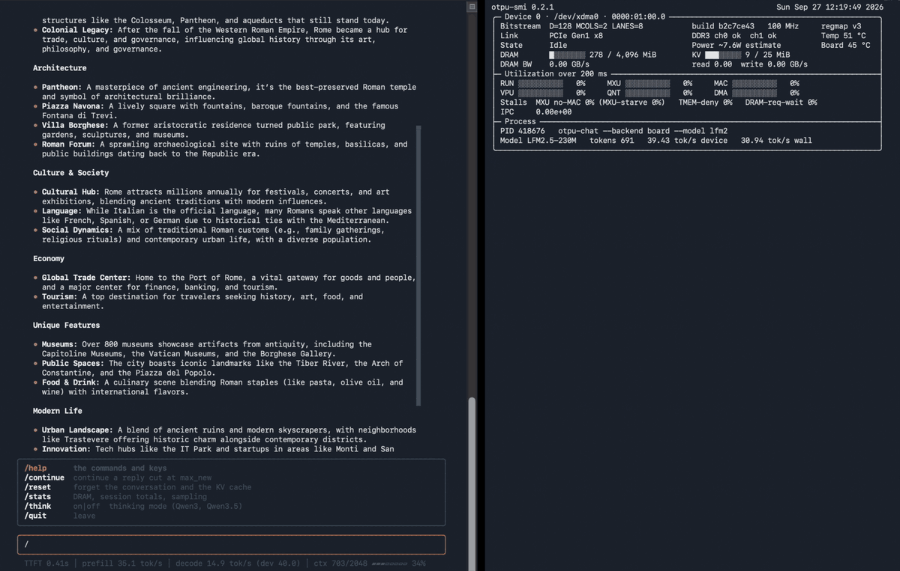
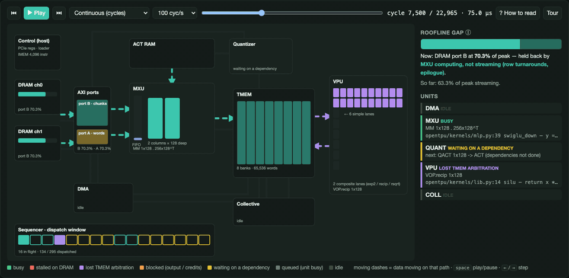

# openTPU

**An open-source AI accelerator, developed by AI.**

openTPU brings the lessons of [auto-arch-tournament](https://github.com/FeSens/auto-arch-tournament)
to AI accelerators. It asks two questions: how far can AI agents go at hardware design, and can
they build the chip that runs their own inference?



*`otpu-chat` running LFM2.5-230M on the FPGA card (left), with `otpu-smi` showing the card's
utilization and DRAM bandwidth (right).*

## A place to learn

openTPU is also a learning project. The whole accelerator lives in one small monorepo that you
can read end to end: the hardware design (SystemVerilog), the instruction set, a bit-exact
simulator, a kernel language and its compiler, and the host software that drives a real PCIe
card. If you want to understand how an AI accelerator works, from a matmul in Python down to
the wires, this is a good place to start.

## Results

The design runs ten modern models with their real weights on an Inspur YPCB-00338 card
(Xilinx Kintex-7 xc7k480t, two DDR3 channels), and the card produces the same tokens as the
simulator, bit for bit.

| Model | Weights | Decode, device | Decode, wall | Prefill, device | DRAM while decoding |
|:--|:--|--:|--:|--:|--:|
| LFM2.5-230M | int8 | 59.0 tok/s | 52.3 tok/s | 295.6 tok/s | 14.5 GB/s (85% of peak) |
| LFM2.5-230M | 4-bit, int8 head | 85.8 tok/s | 82.1 tok/s | 335.4 tok/s | 14.1 GB/s (82%) |
| Qwen3-0.6B | int8 | 21.6 tok/s | 21.3 tok/s | 92.1 tok/s | 14.4 GB/s (84%) |
| Qwen3-0.6B | 4-bit, int8 head | 31.3 tok/s | 30.7 tok/s | 103.4 tok/s | 13.9 GB/s (82%) |
| Qwen3.5-0.8B | int8 | 17.6 tok/s | 16.3 tok/s | 61.4 tok/s | 14.5 GB/s (85%) |
| Qwen3.5-0.8B | 4-bit, int8 head | 24.5 tok/s | 23.3 tok/s | 66.7 tok/s | 14.1 GB/s (83%) |
| Gemma 4 E2B | 4-bit, int8 head | 10.57 tok/s | 10.53 tok/s | 32.1 tok/s | 15.6 GB/s (92%) |
| Gemma 4 E2B | 4-bit, 4-bit head | 12.14 tok/s | 12.09 tok/s | 29.9 tok/s | 15.5 GB/s (91%) |
| LFM2-2.6B | int8 | 6.05 tok/s | 6.03 tok/s | 21.4 tok/s | 16.1 GB/s (94%) |
| LFM2-2.6B | 4-bit, int8 head | 10.96 tok/s | 10.93 tok/s | 20.6 tok/s | 15.8 GB/s (93%) |
| SmolLM3-3B | int8 | 5.00 tok/s | 4.99 tok/s | 21.1 tok/s | 16.0 GB/s (94%) |
| SmolLM3-3B | 4-bit, int8 head | 8.74 tok/s | 8.72 tok/s | 22.8 tok/s | 15.7 GB/s (92%) |
| Phi-4-mini (3.8B) | int8 | 3.99 tok/s | 3.98 tok/s | 13.8 tok/s | 16.0 GB/s (94%) |
| Phi-4-mini (3.8B) | 4-bit, int8 head | 6.56 tok/s | 6.55 tok/s | 15.0 tok/s | 15.8 GB/s (92%) |
| Qwen3.5-2B | int8 | 8.02 tok/s | 8.00 tok/s | 38.2 tok/s | 16.0 GB/s (94%) |
| Qwen3.5-2B | 4-bit, int8 head | 12.09 tok/s | 12.03 tok/s | 41.7 tok/s | 15.8 GB/s (92%) |
| Qwen3.5-4B | 4-bit, int8 head | 5.88 tok/s | 5.87 tok/s | 12.9 tok/s | 15.7 GB/s (92%) |
| Gemma 4 E4B | int8, 4-bit head and down 0-23 | 3.78 tok/s | 3.75 tok/s | 14.8 tok/s | 16.0 GB/s (94%) |

*Measured on the card: the first three models on 2026-09-29 with the production image
`deploy_champ_e698dcd7`. LFM2-2.6B, SmolLM3-3B and Phi-4-mini on 2026-09-30, and Qwen3.5-2B and
4B and Gemma 4 on 2026-10-01, with build B, `deploy_fused133c_79c5707a`, production since then.
Build B decodes LFM2-2.6B, SmolLM3 and Phi-4-mini 8-9% faster than e698dcd7 (Gemma 4 E2B 10%),
at 91-94% of the DRAM peak instead of 82-87%. Qwen3.5-4B's int8 image is over 4 GiB.*
- *The image: main e698dcd at 133.33 MHz, one bitstream for all models. It has LiteDRAM
  controllers calibrated by a small CPU inside the memory core, a four-column systolic matrix
  unit and the stream engine ([docs/stream.md](docs/stream.md)). DDR3-1066, with a 17.1 GB/s
  peak.*
- *The host: the card sits in opentpu (Intel Core i7-4790).*
- *Method, `tools/qual/perf.py`: decode is 64 greedy tokens after a 512-token prompt, with the
  host's argmax in the loop (not streamed). "Device" counts only the cycles the accelerator runs;
  "wall" adds the host. Prefill is the 512-token prompt, on the device.*
- *DRAM traffic comes from the card's own counters while it runs.*
- *Gemma 4 E2B keeps its per-layer embedding tables on the card (3.5-3.6 GiB images;
  [docs/gemma4.md](docs/gemma4.md)); in int8 it does not fit. The base checkpoint (gemma-4-E2B)
  matches Hugging Face's greedy tokens on three prompts with either head. The chat runs the
  instruct checkpoints (gemma-4-E2B-it, ...: the same images and speeds). E4B's table (2.95 GB)
  stays on the host, which copies one 11 KB row into the card per token; its image is 3.96 GiB,
  int8 with the head and the first 24 layers' down projections in 4-bit, as measured here
  ([docs/gemma4_e4b.md](docs/gemma4_e4b.md)). Since 2026-10-09 E4B-it's default is the head and
  the first 12 layers' gate / up projections in 4-bit: the same bytes a token, perplexity
  within 0.01% of int8's instead of +3.2%, and prompt runs of 2 rows instead of 3-4
  ([docs/formats.md](docs/formats.md)).
  In the card's own decode loop (the card picking every token) Gemma 4 decodes faster: E2B
  11.01 / 12.73 tok/s (int8 / 4-bit head), E4B 3.83 tok/s, on the device.*
- *Every configuration matches the simulator token for token, per-position and with the
  resident decode program. More detail in [docs/board.md](docs/board.md).*

With the logits streamed back while the card runs (`tools/decode_profile.py`, 96 tokens), 4-bit
decode is faster, in device / wall tok/s:
- LFM2: 89.5 / 84.5;
- Qwen3: 33.7 / 33.3;
- Qwen3.5: 24.6 / 24.2;
- LFM2-2.6B: 11.07 / 11.02 (build B);
- SmolLM3-3B: 8.92 / 8.89 (build B);
- Phi-4-mini: 6.69 / 6.67 (build B).

The previous production image, se-cand3, was built with the Xilinx MIG, a two-column matrix
unit and a 120.755 MHz clock. Measured the same way, the new image:
- **decode:** within 2.3% of se-cand3's in every configuration. Decode is bound by DRAM, and
  LiteDRAM reads at 82-85% of the DDR3 peak, as the MIG did.
- **prefill:** 1.3x (Qwen3.5) to 2.0x (LFM2 4-bit) faster.
- **calibration:** when the image starts, the core's CPU calibrates both DDR3 channels in 12 s,
  with no host involvement.

The earlier images and their numbers are in [docs/board.md](docs/board.md), section 5.

Mixture-of-experts models bigger than the card's 4 GiB run with their experts streamed from host
storage ([docs/offload.md](docs/offload.md), section 10). The card routes each token and computes
every expert, and it keeps the experts in per-layer slots in its DRAM. The host only copies
missing experts from a pool file into those slots, at the link's rate (section 10.1). Measured
on 2026-10-01 with build B (79c5707a), the card's own decode loop picking every token, 4-bit
experts, int8 head:
- **LFM2.5-8B-A1B** (8.5B parameters, 1.7B active): 10.6 tok/s over 160 tokens. 98.5% of expert
  uses hit the slots, and 5.2 MB streamed per token.
- **Qwen3.5-35B-A3B** (34.7B parameters, 3.0B active): 3.95 tok/s, with Hugging Face's 16
  greedy tokens. 62% of expert uses hit, and 153 MB streamed per token at 1.41 GB/s over PCIe
  (section 10.3).
- Both match the simulator bit for bit.

otpu-chat chats with both, and with gemma-4-26B-A4B-it (`--model lfm2-8b`, `qwen35-35b`,
`gemma4-26b`), with the same engine and settings. Each model's experts are packed once into a
pool file beside its checkpoint, and the chat checks the pool before it loads
([docs/offload.md](docs/offload.md), section 14).

4-bit weights ([docs/quant.md](docs/quant.md)) use FP4 values with two-level block scales, 4.25
bits per weight, and keep the LM head in int8 for accuracy. They cut the bytes per token by about
a third and raise decode speed by 40% (Qwen3.5) to 45% (Qwen3, LFM2), at a measurable cost in
perplexity that docs/quant.md reports per model.

The host is nearly out of the way. For LFM2 and Qwen3 the card runs one decode program compiled
once, which reads the position from a register and looks up its own embedding and RoPE rows, and
the logits stream back while the card is still running: the host adds 0.17 to 0.30 ms per
token on omarchy (0.45 to 1.3 ms on opentpu).
Qwen3.5 runs the same way for decode; its prefill still compiles each chunk's program on the host,
ahead of the card.

### CH1 through Chestnut

The CH1-only image was measured separately on October 16, 2026, at a
100 MHz compute/core clock, with DDR3-800 RAM (400 MHz, 800 MT/s),
2 GiB usable memory and a Chestnut USB3 connection. The workload
is 512 prefill tokens and 64 decode steps, with host argmax and a 1024-token KV cache.

All throughput rates below are **tok/s**. CPU columns use Apple M1 native inference
timings with Q8_0 weights; FPGA columns use device cycles. The same CPU result is
repeated for each FPGA weight profile. RAM BW shows GB/s and percentage of peak.

| Model | FPGA weights | CPU prefill | FPGA prefill | CPU decode | CPU RAM BW | FPGA decode | FPGA RAM BW |
|:--|:--|--:|--:|--:|--:|--:|--:|
| LFM2.5-230M | INT8 | 1021.21 | 132.22 | 93.31 | 26.22 GB/s (38.4%) | 24.87 | 6.10 GB/s (95.3%) |
| LFM2.5-230M | FP4, INT8 head | 1021.21 | 236.13 | 93.31 | 26.22 GB/s (38.4%) | 37.12 | 6.09 GB/s (95.1%) |
| Qwen3-0.6B | INT8 | 189.57 | 43.47 | 25.24 | 20.01 GB/s (29.3%) | 9.16 | 6.10 GB/s (95.2%) |
| Qwen3.5-0.8B | INT8 | 150.74 | 35.08 | 23.68 | 22.69 GB/s (33.2%) | 7.38 | 6.08 GB/s (95.0%) |
| Qwen3.5-2B | INT8 | 95.20 | 15.23 | 16.40 | 35.72 GB/s (52.3%) | 3.07 | 6.10 GB/s (95.4%) |
| LFM2-2.6B | FP4, INT8 head | 69.04 | 9.33 | 11.81 | 35.34 GB/s (51.8%) | 4.22 | 6.10 GB/s (95.3%) |
| SmolLM3-3B | FP4, INT8 head | 51.98 | 15.61 | 6.60 | 26.03 GB/s (38.1%) | 3.39 | 6.10 GB/s (95.3%) |

FPGA RAM BW is decode read/write traffic divided by accumulated device RUNNING
time, as a percentage of **one physical CH1's 6.4 GB/s peak**. It excludes host
idle time; both logical memory regions share CH1. CPU RAM BW uses the M1's measured
PCPU/ECPU DCS byte counters during the same decode pass, relative to its nominal
[68.25 GB/s peak](https://research-information.bris.ac.uk/files/314256436/paper.pdf).
CPU bandwidth includes background CPU processes and excludes GPU/I/O clients.

Completed runs passed exact ISA token checks and had zero ECC errors. The current
USB control path reads full logits after each decode step, so end-to-end throughput
is lower than the FPGA device rates shown. [CH1 benchmark details and model coverage](docs/chestnut_ch1_benchmarks.md)
include the reproducible scripts and per-model test status.

A separate LFM2.5-230M int8 diagnostic measured the FPGA die during active inference:
54.38–56.85 °C during prefill and 54.38–56.11 °C during decode. The free-running
UPTIME counter measured approximately 100 MHz through both phases, with zero ECC errors.
[Temperature and clock samples](docs/data/chestnut_ch1_thermal_20261016.json) are recorded
separately; the diagnostic's extra sensor reads are excluded from the throughput table.

#### Native CPU comparison

The same six models were measured on an Apple M1 MacBook Air with 8 GiB RAM,
using llama.cpp 0.5.0, eight CPU threads and no GPU backend. These are wall-clock
rates for the same 512 prompt token IDs and 64 decode steps, with a 1024-token
context, after warmup. Each row is one timed pass; conversion and model loading
are excluded. CPU GGUF Q8_0 weights differ from the FPGA INT8/FP4 formats.
CPU timings were remeasured alongside the DRAM counters; the latest counter-enabled
passes are shown, with paired counter-off/on checks for the two small Qwen models
retained in the CPU data.

[CPU receipts and conversion audits](docs/data/chestnut_cpu_20261016.json) record
timings, checkpoint revisions, token IDs and runtime hashes.
[Benchmark details and reproduction](docs/chestnut_ch1_benchmarks.md#native-cpu-comparison)
describe the different quantization and timing conditions; host background
activity and CPU frequency were not controlled.

### 4 GiB spare-lane image through Chestnut

On October 18, 2026, build `c0182863` ran Qwen3.5-2B INT8 through Chestnut
on both physical 2 GiB channels at 148.837 MHz core / DDR3-1066.667, following
the `c0182800` result at 100 MHz / DDR3-800. The new image adds a quantizer
predicate timing correction and retains the repaired shared CH0 response bus,
two pipelined native ports and registered host reset. Both JTAG USER2 and PCIe
provide runtime memory/control access, with a 250 MHz host clock independent
of PCIe. CH0 uses physical lanes
`0,1,2,3,4,5,8,7` without ECC; CH1 retains ECC. This experimental image is
separate from the production and CH1-only results above.

All rows below used 512 Austen prompt tokens followed by 32 greedy decode
steps, resident decode, host argmax and a 4096-token KV capacity. Each is one
timed pass; checkpoint conversion, model upload, initialization and the separate
ISA correctness check are excluded. Wall rates include program compilation,
transfers, polling, full-logit USB readback and host argmax. Both c018 images
include exact program readback before each instruction-memory load.
The 3.77 GiB image includes weights, embedding/lookup tables, I/O and cache/state;
with program space, it occupies 94.2% of the FPGA's 4 GiB.

| Build | What changed | Prefill, device | Prefill, wall | Decode, device | Decode, wall | DRAM while decoding |
|:--|:--|--:|--:|--:|--:|--:|
| `c0172080` (Oct 17, historical) | Serialized CH0 reads; PCIe runtime | 2.28 tok/s | 2.05 tok/s | 0.45 tok/s | 0.26 tok/s | 0.89 GB/s (6.9% of 12.8 GB/s peak) |
| `c0182800` (Oct 18, previous) | Shared-bus read repair, pipelined CH0, registered host reset; 100 MHz / DDR800; JTAG + PCIe runtime | 23.38 tok/s | 8.90 tok/s | 5.78 tok/s | 0.62 tok/s | 11.51 GB/s (89.9% of 12.8 GB/s peak) |
| **`c0182863` (Oct 18)** | **148.837 MHz / DDR1066, quantizer predicate timing correction; retained JTAG + PCIe runtime** | **31.36 tok/s** | **9.58 tok/s** | **7.73 tok/s** | **0.57 tok/s** | **15.38 GB/s (90.1% of 17.07 GB/s peak)** |

Compared with `c0182800`, the new image improves device prefill **34.1%**,
device decode **33.7%** and decode memory bandwidth **33.7%**. Wall prefill
improves **7.6%**, while wall decode is **8.0% slower** in this pass
(0.567 vs 0.616 tok/s). Host/USB overhead dominates wall time; the regression
has not been isolated to a particular component. The checkpoint, configuration,
memory allocation and all 32 benchmark token IDs match between these images.
Each result is one pass at a separate time, with uncontrolled host conditions;
the core clock, DDR rate and timing correction changed together.

At DDR800, `c0182800` achieved **1.89x** the earlier single-CH1 bandwidth
(11.51 vs 6.10 GB/s); device decode improves **1.88x** (5.78 vs 3.07 tok/s).
End-to-end decode improves **1.17x** (0.616 vs 0.527 tok/s), with host/USB
overhead still dominant. Traffic per token is almost unchanged: 1.990 vs
1.989 GB. The CH1 baseline used a 1024-token cache, nonresident decode and
64 decode steps; these are separate measured runs, not a controlled A/B.

The latest benchmark reused the completed same-boot initialization after
checking its exact-image binding, live marker and calibration. Zero write and
readback had covered the full 4 GiB during the preceding LFM test.
All eight chat tokens matched fresh ISA exactly ("The capital of France is
Paris."); the 32 benchmark tokens also matched the earlier CH1 run's prefix.
Physical matmul, four image boundary samples and all **137 program readbacks**
passed. Calibration stayed unchanged, CH1 ECC counters stayed at zero, and
temporary PCIe settings were restored. Full memory payload coverage and
cold/warm repeatability remain unqualified. Uploading the image in 4 MiB host
chunks took 56.9 s (71.1 MB/s), outside the throughput timings above.

[Current counters, image/checkpoint hashes, correctness and comparison data](docs/data/spare_pcie_benchmark_c0182863_20261018.json)
record the new run; [Mac instructions](docs/mac_c0182863.md#compare-the-same-qwen35-2b-workload)
provide the reusable benchmark command. The
[c0182800 record](docs/data/spare_pcie_benchmark_20261018.json) preserves the
previous pipelined result. The
[October 17 record](docs/data/spare_pcie_benchmark_20261017.json) preserves the
older serialized-CH0 result and its diagnosis.

**Automatic CH0 startup calibration has passed local tests** in
[c0182600](docs/mac_c0182600.md) and [c0182663](docs/mac_c0182663.md): both-channel
startup, memory initialization, exact matmul and TinyStories completed. Their
Mac PCIe/LFM/Qwen acceptance, cold/warm repeatability and publication of the local
runtime handoffs remain pending. The Mac-tested c0182800/c0182863 images still
calibrate only CH1 automatically and require the matching CH0 host helper after
power-up or FPGA reload. Automatic calibration does not remove the memory
initializer's fixed host pauses.

## How it works

```
  Kernels in ol              mlp, attention, full model layers
        |  @ol.jit
  Language + compiler        layouts, affine loop addressing, fusion
        |
  ISA                        8 x 32-bit words per instruction
        |
  ISA simulator  <======>  RTL          same bits, checked by the tests
  (Python)                 (SystemVerilog)
                            |  Vivado bitstream
                           FPGA card    Kintex-7 xc7k480t
                            |  PCIe
                           Host         otpu-chat, otpu-smi, otpu-lens
```

The machine is deliberately simple. A sequencer issues one instruction per cycle to a few
units: DMA moves data, the matrix unit multiplies int8 weights streamed from DRAM, the vector
unit does fp32 math, and a quantizer turns results back into int8. There is no cache and no
hidden scheduling: every data movement is an instruction, so a trace shows exactly where the
cycles go. [docs/isa.md](docs/isa.md) describes the whole instruction set.

A kernel looks like this:

```python
from opentpu import language as ol

@ol.jit
def mlp(h, gamma, w_gate, w_up, w_down, out, eps):   # simplified; see kernels/mlp.py
    x = ol.load(h)
    xs = ol.quantize(rmsnorm(x, ol.load(gamma), eps))
    g = ol.dot(xs, w_gate)
    u = ol.dot(xs, w_up)
    a = ol.all_gather(silu(g) * u)
    y = ol.all_gather(ol.dot(a, w_down))
    if ol.program_id() == 0:
        ol.store(out, x + y)
```

Because every data movement is an instruction, a trace of a run explains its speed. Lens, the
profiler, records a run from the RTL, the simulator or the card and opens it in the browser,
with a roofline, a timeline and per-instruction tables ([docs/lens.md](docs/lens.md)).



*Lens replaying part of a Qwen3 decode step. Colours show what each unit is doing in each
cycle: busy, waiting on DRAM, or waiting on another instruction.*

## ASIC flow

Besides the FPGA card, openTPU also builds as a chip layout: an ASIC block on the open NanGate45
(45 nm) cell library, with 33 SRAM macros and ~560k standard cells. It is built end-to-end by AI
agents, from the SystemVerilog source to a routed layout, on open-source tools only: Yosys for
synthesis, OpenROAD for place and route, and [OpenLayout](https://github.com/fenggev56/OpenLayout)'s
agent skills for the physical-design decisions.

```
RTL → synthesis → floorplan → macro placement → place / CTS / route → timing (STA)
 ↑                           (OpenLayout agents)   (timing repair)          │
 └──────────── change the RTL, verify it bit-exact ←────────────────────────┘
```

**What each step does**

- **Synthesis** turns the RTL into a netlist of library cells; the SRAMs stay as hard macros.
- **Macro placement** decides where the 33 large SRAM blocks sit on the die. Every wire after it
  depends on that choice, so it decides whether the chip routes and how fast it runs. AI placer can beat all the traditional algorithms.
- **Place / CTS / route** places the standard cells, builds the clock tree and draws the wires,
  repairing timing (buffers, resizing) along the way.
- **STA** (static timing analysis) reports the routed layout's slowest paths and by how much they
  miss the clock.

**Use it on your own design.** [docs/asic_timing_loop.md](docs/asic_timing_loop.md) describes the
loop step by step, includes a ready-to-fill prompt that hands the whole loop to a coding agent (any
design, any node), and records the openTPU run and the pitfalls met on the way.

## Try it

Everything except the card runs on a laptop.

```sh
pip install -e .
pip install pytest torch transformers
python3 -m pytest -q          # RTL tests also need Verilator 5

hf download LiquidAI/LFM2.5-230M --local-dir models/LFM2.5-230M
otpu-chat --model lfm2 --backend isa    # chat on the simulator
```

With a card, build the bitstream (`make bit` in [`boards/ypcb-00338`](boards/ypcb-00338)), load
it over JTAG, then run `sudo otpu-setup` and `otpu-chat --backend board`.
[docs/board.md](docs/board.md) walks through the bring-up.
The upstream FPGA build uses full Vivado. For Linux dependencies and portable
commands, see [Linux setup](docs/linux_setup.md). For this workspace's
openXC7 port and JTAG-only first connection, see
[hardware bring-up notes](docs/fedora_bringup.md); its implementation and
hardware validation status are tracked separately from the results above.
For the tested standalone JTAG image, follow the
[Vivado bitstream guide](docs/vivado_bitstream_guide.md). Exact file locations,
the JTAG/PCIe build differences and current verification status are in the
[bitstream index](docs/bitstreams.md); the
[permanent PCIe guide](docs/permanent_pcie_ch1.md) records the completed flash
write; the [October 16 Chestnut measurements](docs/chestnut_ch1_benchmarks.md)
record the subsequent Mac PCIe model tests. The historical PCIe/2 GiB release and its
matched DDR800 data are included in [bitstreams/ch1-pcie-2gb](bitstreams/ch1-pcie-2gb/),
with [historical build and loading records](docs/vivado_bitstream_guide.md#rebuild-the-current-ch1-pcie-release-on-fedora).
The retained 4 GiB fixed-clock images [c0182800](docs/mac_c0182800.md) and
[c0182863](docs/mac_c0182863.md) provide both JTAG and PCIe runtime access and
have passing Mac LFM/Qwen receipts. The
[tested-build and outstanding-test table](docs/bitstreams.md#tested-builds-and-outstanding-tests)
also includes the locally tested automatic-startup builds c0182600/c0182663 and
optional c0182461 comparison, whose Mac acceptance remains pending. It separates
build/review, SRAM workloads, permanent programming and Mac results, with exact
hashes and remaining qualification limits. The automatic-startup guides describe
local preparation; their matching host/runtime files require separate review and
publication before Mac use. The c01848 runtime-clock effort was
abandoned on October 22; [HANDOFF.md](HANDOFF.md) records that final disposition.
The [CH1 compute experiment](docs/ch1_compute_clock.md),
[RAM-only investigation](docs/ddr_ram_only_debug.md) and
[serializer-reset metadata](bitstreams/ch1-pcie-2gb-ch0-reset/) are historical
references. Their local artifacts and retired rebuild paths are described in
the [bitstream index](docs/bitstreams.md#historical-inventory-and-local-artifacts).
The [OpenXC7 bitstream plan](docs/openxc7_bitstream_plan.md) records the preserved
placement, live routing measurements, upstream fixes and remaining checks.
The current status and elapsed times are in [progress.md](progress.md).
The canonical local checkout is `~/openTPU`; shared tools and the other
projects are under `~/ypcb`. See the [workspace layout](docs/workspace_layout.md)
for compatibility paths, repository boundaries and transfer artifacts.

| Command | What it does |
|:--|:--|
| `otpu-chat` | chat with Qwen3-0.6B, LFM2.5-230M (`--model lfm2`), Qwen3.5-0.8B (`--model qwen35`), LFM2-2.6B (`lfm2-2.6b`), SmolLM3-3B (`smollm3`), Phi-4-mini (`phi4-mini`) or Qwen3.5-2B / 4B (`qwen35-2b`, `qwen35-4b`), Gemma 4 E2B / E4B (`gemma4`, `gemma4-e4b`: the instruct checkpoints, gemma-4-E2B-it / E4B-it); MoE models bigger than the card with their experts streamed: LFM2.5-8B-A1B (`lfm2-8b`), Qwen3.5-35B-A3B (`qwen35-35b`), gemma-4-26B-A4B-it (`gemma4-26b`); a checkpoint without a chat template (a base model) only with `--raw` |
| `otpu-serve` | an OpenAI-style API server (`/v1/chat/completions`, `/v1/completions`, streamed or not; SGLang's `/generate`) for many clients at once: their contexts kept on the card and in host RAM / on disk (a prompt continuing a saved one feeds only the rest), their decode steps batched on the card for Qwen3 and the Llama-likes, every token picked on the card (Qwen3-0.6B: 78 tok/s with 4 clients, 25 alone); [docs/serve.md](docs/serve.md) |
| `otpu-smi` | temperature, power, DRAM bandwidth and per-unit utilization; `-l --csv` logs a time series |
| `otpu-lens` | record a run and open it in the profiler (`summary` prints the overview in the terminal) |
| `otpu-selftest`, `otpu-diag` | check that the card works |

## Validating against Hugging Face

`tools/validate.py` checks a device's greedy tokens and logits against a CPU golden: the same
checkpoint in Hugging Face transformers, fp32 on the CPU, with openTPU's quantization. The
golden's weights are the values the matrix unit multiplies (the model image's own quantizer,
in the formats you pick), and its activations are rounded to int8 per 128 values wherever the
device's quantizer rounds them: every matmul input, and in attention the query, K, V and the
softmax weights. The device is the ISA simulator, the RTL (Verilator) or the card, and
`--against` adds a second device that must give the same tokens and bit-identical logits. It
is measured on Qwen3-0.6B, LFM2.5-230M, Qwen3.5-0.8B and Gemma 4 E2B (base and instruct); the
MoE models are not supported.

```sh
python3 tools/validate.py --model qwen3                                    # ISA simulator, int8
python3 tools/validate.py --model lfm2 --wformat fp4 --head-format int8   # 4-bit layers
python3 tools/validate.py --model gemma4                                   # E2B-it: 16 GB (below)

# the RTL against the ISA simulator, bit for bit: slow, so one prompt and a few tokens
# (this one takes 4 minutes on a 16-core host, the Verilator build included)
python3 tools/validate.py --model lfm2 --backend rtl --against isa --tokens 3 "The capital of France is"

# the card against the ISA simulator, bit for bit, on the card host
otpu-lock -- python3 tools/validate.py --model qwen3 --backend board --against isa

# or only the card's run under the lock, and the rest on another host: the ISA simulator then
# runs in the configuration the card ran in
otpu-lock -- python3 tools/validate.py --model qwen3 --backend board --no-golden --save card.npz
python3 tools/validate.py --model qwen3 --against card.npz
```

Each prompt (eight by default, 16 tokens each) prints the device's continuation and the
goldens'. Then the device's own tokens are fed to the golden, so that every step compares the
same context, and the tool prints the top-1 agreement, the mean and largest KL divergence, the
largest logit difference and the lowest cosine. The summary has four rows:

| Row | What it is |
|:--|:--|
| device vs W+A | the device against the quantized golden: the check |
| device vs fp32 | the device against the plain checkpoint |
| W+A vs fp32 | what the quantization alone costs |
| W+A~ vs W+A | the golden against itself with its inputs nudged by one fp32 ulp: the floor |

The golden cannot round exactly as the device does: its sums, norms and exponentials differ in
the last bits. Once one int8 value rounds the other way, the difference spreads through the
layers after it. So on a real model the device sits about as far from the quantized golden as
the golden sits from itself after a one-ulp nudge, and a healthy device is near that floor.
With 4-bit weights the floor is far below the fp32 rows. Measured on the ISA simulator, with
the eight default prompts and 16 tokens each:

| Model | Weights | device vs W+A: top-1, KL | floor KL | device vs fp32: top-1, KL | W+A vs fp32 KL |
|:--|:--|--:|--:|--:|--:|
| LFM2.5-230M | int8 | 96.2%, 0.0038 | 0.0039 | 96.2%, 0.0055 | 0.0050 |
| LFM2.5-230M | 4-bit, int8 head | 94.6%, 0.0045 | 0.0041 | 80.6%, 0.152 | 0.157 |
| Qwen3-0.6B | int8 | 96.1%, 0.0088 | 0.0109 | 96.1%, 0.011 | 0.012 |
| Qwen3-0.6B | 4-bit, int8 head | 96.9%, 0.0123 | 0.0163 | 85.9%, 0.193 | 0.195 |
| Qwen3.5-0.8B | int8 | 96.1%, 0.0020 | 0.0017 | 97.7%, 0.0033 | 0.0029 |
| Qwen3.5-0.8B | 4-bit, int8 head | 96.9%, 0.0020 | 0.0021 | 88.3%, 0.076 | 0.077 |
| Gemma 4 E2B (base) | int8, 4-bit PLE table | 100.0%, 0.0036 | 0.0035 | 99.2%, 0.015 | 0.017 |
| Gemma 4 E2B (base) | 4-bit, int8 head and PLE table | 99.2%, 0.0029 | 0.0036 | 96.9%, 0.045 | 0.043 |
| Gemma 4 E2B-it | int8, 4-bit PLE table | 100.0%, 0.0071 | 0.0078 | 97.5%, 0.014 | 0.0085 |
| Gemma 4 E2B-it | 4-bit, int8 head and PLE table | 98.6%, 0.0095 | 0.0136 | 93.1%, 0.102 | 0.093 |
| Gemma 4 E2B-it | the base's mix, int8 head and PLE table | 100.0%, 0.0135 | 0.0075 | 98.6%, 0.028 | 0.036 |

KL is the mean KL(golden || device) in nats per token. The device's KL from the quantized
golden is 0.70 to 1.16 times the floor's, and its distance from fp32 is what the quantization
alone predicts. A run takes 2 to 14 minutes on a 16-core host (Gemma 4 E2B: 16 and 26, the
host shared with other jobs; E2B-it 8 to 14 on omarchy alone) and peaks at 2.5 GB (LFM2) to
16 GB (Gemma 4 E2B). Gemma 4 E2B-it, the instruct checkpoint otpu-chat runs (2026-10-09, tree
aa2166b1), answers most prompts in a few tokens and stops at its end of turn (`<turn|>`): its
rows have 71 to 81 positions against the base's 128, so one position weighs more. The mix's
1.80x is one position of 71, a near tie in `def fibonacci(n):`'s (KL 0.69, the floor's 0.17
there); without it, 0.75x. The prompts
are plain text after `<bos>`, as the base's, which the instruct tokenizer does not add
(`gemma4.text_ids`).

Qwen3's activation rounding costs more than the other models': its k_norm gains have outlier
channels (Qwen3-0.6B: up to 42 times their median), and K is rounded to int8 with one scale per
token, head and 128 values, so the other channels, the ones the attention scores depend on, were
left with a few levels. Its int8 W+A golden was 0.042 from fp32, against 0.0050 for LFM2.5-230M
and 0.0029 for Qwen3.5-0.8B. The image now moves the outliers' magnitude from K into q (a power
of two per channel in the q_norm and k_norm gains, which leaves q . K unchanged; docs/quant.md,
"K smoothing"): 0.012 in the table. On two fixed texts (2,046 positions, paired) it takes the
int8 W+A golden's KL from 0.059 to 0.015 and the 4-bit one's from 0.221 to 0.179, and the ISA
simulator's on 512 of them from 0.064 to 0.019 (int8) and from 0.228 to 0.195 (4-bit, int8
head). The 4-bit row's 128 greedy positions are too few to show that drop (each run is on its
own tokens, and a few positions dominate).

Gemma 4 runs in its image's formats, which follow the card's fit (E2B's int8 image keeps its
per-layer-embedding table in 4-bit). The golden takes its embedding rows from the LM head, as
the device gathers them, its per-layer embeddings from the device's PLE records, and it
compares the logits after the soft cap. E2B in fp32 is about 20 GB, so Hugging Face loads the
language model alone, without its 9.4 GB PLE table (the golden reads the rows it needs from the
checkpoint), and the golden keeps the bf16 checkpoint's weights in bf16, which is exact, and
widens them a matrix at a time for its fp32 passes. An E2B run peaks at 16 GB: give it a host
with 22 GB free.

A run passes when the device agrees with the quantized golden on at least 80% of the top-1
tokens and its mean KL is at most three times the floor's (`--min-top1`, `--kl-ratio`), and,
with `--against`, when both devices give the same tokens and bit-identical logits. The exit
status is 0 for PASS and 1 for FAIL, and `--json` writes every step for scripts.
`--weights-only` drops the activation rounding from the golden (then only the top-1 bound
holds), and `--no-fp32` skips the fp32 rows.

On the card (build 1025907f, 2026-10-07: `--no-golden --save` under the lock, `--against` on a
build host), all six runs of Qwen3-0.6B, LFM2.5-230M and Qwen3.5-0.8B, in int8 and in 4-bit
with an int8 head, gave the ISA simulator's tokens and bit-identical logits on every prompt
(0 ulp over 103 to 128 steps a run). The card's mean KL from the quantized golden was 0.94 to
1.39 times the floor, with 94.5% to 97.7% top-1 agreement. Qwen3-0.6B int8's KL from fp32 on
the card went from 0.052 (build 84989047, before K smoothing) to 0.012.

## Where to start reading

1. [docs/isa.md](docs/isa.md): the instruction set. Everything else is built on it.
2. [`opentpu/kernels`](opentpu/kernels) and [docs/compiler.md](docs/compiler.md): how a kernel
   becomes instructions.
3. [`opentpu/isasim.py`](opentpu/isasim.py): the simulator, which is the spec.
   [docs/bend.md](docs/bend.md): the same simulator in Bend, with laws about its arithmetic
   and 10-15x isasim's speed.
4. [`rtl/`](rtl): the hardware, starting from [`rtl/top/otpu_top.sv`](rtl/top/otpu_top.sv).
5. [docs/lfm2.md](docs/lfm2.md), [docs/qwen35.md](docs/qwen35.md), [docs/llama.md](docs/llama.md),
   [docs/benchmarks.md](docs/benchmarks.md): whole models and where their cycles go.
6. [docs/board.md](docs/board.md): the physical card, from clocks to PCIe.
7. [docs/targets.md](docs/targets.md): how one design builds for several boards and chips (a
   target file per build: `targets/*.toml`).

## What's next

- **The last few percent of DRAM.** Decode is bound by DRAM efficiency: it reads 82 to 85% of the
  DDR3-1066 peak. Work on the LiteDRAM path's efficiency is under way.
- **Timing margin and area.** The design closes 133.33 MHz, the clock at which the 128-byte port
  matches the two DDR3 channels, but only just (WNS +0.032 ns). A tournament of Vivado runs keeps
  working on its margin and area. Decode is bound by DRAM, so a faster clock mostly helps prefill.
- **Faster prefill.** The four-column systolic matrix unit is in the production image; prefill is
  still limited by the matrix unit's multiply rate.

- **More targets.** The design builds from target files (`targets/*.toml`,
  [docs/targets.md](docs/targets.md)): the YPCB-00338 in production, the BCU1525 (Virtex
  UltraScale+ VU9P, four DDR4 DIMMs) being brought up, and ASICs, starting with NanGate45 and
  OpenROAD for area, clock and power numbers.

## Contributing

Issues and pull requests are welcome, and most of the work needs only Python and Verilator, not
an FPGA. Changes to the ISA, the simulator or the RTL must keep `python3 -m pytest -q` passing,
and performance claims should say how they were measured.

## License

Apache License 2.0. See [LICENSE](LICENSE).
