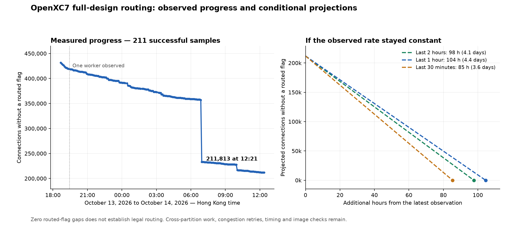

# OpenXC7 routing progress and conditional time estimate

At **October 14, 2026 12:21 HKT**, the native router is active in serial
cross-partition routing, with **211,813** unique driven net/sink-wire connections
without a routed flag. The current attempt has run about **23 hours
27 minutes**; overall OpenXC7 work has already taken days.



The plot uses **211 successful samples**, from October 13 at 18:40 to October 14
at 12:21 HKT, all with the same native PID 400903/start tick 21826315,
connection inventory and first router iteration. The remaining count fell from
**431,793 to 211,813**. The latest five-minute decrease was **0 connections**.
The 00:21, 01:41 and 03:06 observer timeouts are excluded; subsequent samples
succeeded without restarting the native route.

| Measurement window ending 12:21 HKT | Average decrease per hour | Mechanical time to zero at that constant rate |
| --- | ---: | ---: |
| Last 2 hours | 2,168 connections | 98 hours / 4.1 days |
| Last 1 hour | 2,027 connections | 104 hours / 4.4 days |
| Last 30 minutes | 2,482 connections | 85 hours / 3.6 days |

**The latest one- and two-hour rates project 98–104 additional hours, about
4.1–4.4 days, to clear the remaining flags if those rates stay constant.**
None of these windows is dominated by one sampling interval. These scenarios
are not confidence intervals or promised finish times. Congestion legality,
further retries, full numerical timing and final image qualification remain.

For the user's **12:06 HKT / 211,896 remaining / 352 cleared in five minutes**
snapshot, extending that single interval gives 4,224 connections/hour and
**50.2 hours** to zero. That interval alone is too short to give a dependable
completion estimate; the plot compares longer recent windows instead.

The [12:01 snapshot](plots/openxc7_routing_progress_20261014T040137Z.json)
projected 80–96 hours from its one- and two-hour rates; the half-hour projected
107 hours with 58% of its decrease in the 572-connection interval at 11:56.
The latest estimates shifted as the recent windows advanced.

At **10:01 HKT**, an independent comparison of the saved per-arc records confirmed **11,092 gains
across 29 nets**, including **10,813 on net index 559412**, with zero observed
losses. Both 1,693,833-entry unique flag vectors were regenerated exactly.
The per-arc group bytes, all sink identities, process, inventory and first
iteration were unchanged. Net indices alone do not establish signal names or
types. These observations prove the flag decrease, not legal routing.
[Independent 10:01 burst audit](../build/fedora-openxc7/full-congestion-model-restored-isolated-route-20261013T045700Z/connection-burst-audit-20261014T020440Z.json).

At **06:56 HKT**, an independent comparison of the saved per-arc records
confirmed **123,892 gains across 29 nets**, with **123,488 gains on net index
588801**. Every unique connection identity and routed flag was reproduced;
per-arc group bytes and sink identities were unchanged, with zero observed
losses. The process, inventory, serial phase and iteration also remained the
same. This proves the sampled flag decrease, not legal routing.
[Independent burst audit](../build/fedora-openxc7/full-congestion-model-restored-isolated-route-20261013T045700Z/connection-burst-audit-20261013T225805Z.json).

The [11:31 snapshot](plots/openxc7_routing_progress_20261014T033137Z.json)
projected 65–80 hours from its hour and half-hour rates. Those windows were
also not dominated by one sampling interval; their rates were faster than
those in the newest snapshot.
The [11:01 snapshot](plots/openxc7_routing_progress_20261014T030137Z.json)
projected 105–121 hours from its hour and half-hour rates. Those windows
were also not dominated by one sampling interval.
The [10:31 snapshot](plots/openxc7_routing_progress_20261014T023137Z.json)
projected 142 hours from its half-hour rate. Its one- and two-hour windows
were still dominated by the concentrated event.
The [10:01 snapshot](plots/openxc7_routing_progress_20261014T020137Z.json)
produced 9–30-hour projections with all three windows dominated by that
concentrated gain. The latest half-hour now provides a separate slower rate.
The [09:56 snapshot](plots/openxc7_routing_progress_20261014T015638Z.json)
projected 126–207 hours from its one- and two-hour rates and 230 hours from
its half-hour, before the newly verified concentrated gain.
The [09:26 snapshot](plots/openxc7_routing_progress_20261014T012637Z.json)
projected 102–113 hours from its one- and two-hour rates and 189 hours from
its half-hour. The newest hour cleared about half as many connections as
that snapshot's hour, increasing the corresponding projection to 207 hours.
The [08:56 snapshot](plots/openxc7_routing_progress_20261014T005637Z.json)
projected 70–105 hours from rates that also excluded the concentrated event.
The newest slower half-hour illustrates how much the forecast can change.
The [08:26 snapshot](plots/openxc7_routing_progress_20261014T002637Z.json)
projected about 129 hours from its post-burst hour and half-hour; its two-hour
window still included the concentrated event.
The [07:56 snapshot](plots/openxc7_routing_progress_20261013T235637Z.json)
projected 127–128 hours from its post-burst hour and half-hour.
The [07:26 snapshot](plots/openxc7_routing_progress_20261013T232638Z.json)
projected about 125 hours from its post-burst half-hour. Its one- and two-hour
values still included the concentrated event.
The [06:56 snapshot](plots/openxc7_routing_progress_20261013T225637Z.json)
produced naive 0.9–3.6-hour projections dominated by that event.
Subtracting only that net's 123,488 gains gave 73–98-hour sensitivity scenarios.
These earlier calculations also assumed constant speed and did not establish
a successful-routing or bitstream-completion deadline.

The [06:26 snapshot](plots/openxc7_routing_progress_20261013T222638Z.json)
projected 151–186 hours from its longer averages and 227 hours from its half-hour,
before this concentrated decrease. Preserve these historical projections as
evidence that routing speed and the composition of remaining work can change.
The [06:06 snapshot](plots/openxc7_routing_progress_20261013T220638Z.json)
projected 126–162 hours from its longer averages and 500 hours from its half-hour.
The [05:36 snapshot](plots/openxc7_routing_progress_20261013T213637Z.json)
projected 115–119 hours from its longer averages and 97 hours from its half-hour.
The [05:06 snapshot](plots/openxc7_routing_progress_20261013T210637Z.json)
projected 66–104 hours from its longer averages and 156 hours from its half-hour.
The [04:36 snapshot](plots/openxc7_routing_progress_20261013T203637Z.json)
projected 57–111 hours from its longer averages and 78 hours from its half-hour.
The [04:06 snapshot](plots/openxc7_routing_progress_20261013T200638Z.json)
projected 49–54 hours from its longer averages and 198 hours from its half-hour.
The [03:36 snapshot](plots/openxc7_routing_progress_20261013T193638Z.json)
projected 39–52 hours from its longer averages and 28 hours from its half-hour.
The [03:31 snapshot](plots/openxc7_routing_progress_20261013T193137Z.json)
projected 53–61 hours from its longer averages and 39 hours from its half-hour.
The [03:01 snapshot](plots/openxc7_routing_progress_20261013T190140Z.json)
projected 64–86 hours from its longer averages and 83 hours from its half-hour.
The [02:31 snapshot](plots/openxc7_routing_progress_20261013T183139Z.json)
projected 70–75 and 52 hours. The
[02:01 snapshot](plots/openxc7_routing_progress_20261013T180139Z.json)
projected 135–136 hours from its slower serial hour/half-hour. Keep these
historical projections as evidence of variability, not promised finish times.

The calculation is `remaining / average_connections_removed_per_hour`. The
starting count for each exact time window is interpolated between adjacent
snapshots, preventing subsecond sample jitter from dropping a five-minute
interval. Precise intermediate values are retained in the JSON, but the table
rounds the estimates because routing speed is variable.

## Why this does not predict a finished bitstream

The remaining counter measures routed flags; it does not certify routing
legality. At the plotted snapshot the router has finished the horizontal
batches and is processing the serial cross-partition batch, initially containing
70,693 scheduled nets. Its current net position and search queues could not be
read because an optimized debug parameter was unavailable. This missing
measurement does not imply that the batch is complete. The earlier observation
also recorded 31 deferred local failures. Scheduled nets and individual
connections are different counts and must not be added together.

Work can become faster or slower when the phase changes. Subsequent congestion
iterations may rip up and reroute connections. After native routing completes,
full numerical timing and the strict image checks still need to pass. No finite
successful-routing ETA is established by these projections.

A separate **05:20 HKT** read-only log audit found a combined search queue of
**5,480,671 entries** on `u_ld.csrbank0_base_r[14]` at its five-million-iteration
warning. The pinned source confirms that the warning reports actual forward
and backward queue sizes. This is the largest queue snapshot among 31 captured
warnings, not an all-time peak or a cumulative retry count. It provides evidence
of costly individual searches without proving a stall or non-convergence.
[Queue audit and source hash](../build/fedora-openxc7/full-congestion-model-restored-isolated-route-20261013T045700Z/warning-queue-audit-20261013T212012Z.json).

The **06:02 HKT** follow-up audit captured **5,575,442 combined queue entries**
on `u_ld.csrbank0_errors_r[27]` at **10 million search iterations**. The same
connection's earlier 5-million-iteration warning had 4,485,469 queue entries.
This demonstrates growth during one expensive search; it does not establish
global non-convergence or a terminal route failure.
[Updated queue audit](../build/fedora-openxc7/full-congestion-model-restored-isolated-route-20261013T045700Z/warning-queue-audit-20261013T220216Z.json).

At **08:03 HKT**, the source-verified log audit covered **44 warnings** and
found that the largest recorded combined queue remained **5,575,442 entries**.
The newest warning had 3,583,876 entries on another activation-memory
connection. This shows continuing searches without a new larger recorded
queue; it does not prove convergence or bound queue peaks between warnings.
[08:03 queue audit](../build/fedora-openxc7/full-congestion-model-restored-isolated-route-20261013T045700Z/warning-queue-audit-20261014T000317Z.json).

At **09:04 HKT**, the source-verified log audit covered **52 warnings** and
found a largest recorded combined queue of **5,575,442 entries**.
The newest warning had 3,122,067 entries. These logged snapshots
provide no bound on between-warning peaks or proof of routing convergence.
[09:04 queue audit](../build/fedora-openxc7/full-congestion-model-restored-isolated-route-20261013T045700Z/warning-queue-audit-20261014T010419Z.json).

At **09:31 HKT**, the source-verified audit covered **58 warnings**
and recorded a new largest logged queue snapshot of **6,605,853 entries**
on `u_ld.csrbank0_errors_r[29]` at 10,000,000 search iterations.
The same connection's earlier five-million-iteration warning had
**5,278,388 entries**. The router remains live, with
**11.62 GiB** cgroup memory under its **24 GiB** cap, no router swap,
and zero memory-limit/OOM events. Growing queues on this individual search
do not prove a global stall or establish a convergence deadline.
[Updated queue audit](../build/fedora-openxc7/full-congestion-model-restored-isolated-route-20261013T045700Z/warning-queue-audit-20261014T013121Z.json) ·
[Resource audit](../build/fedora-openxc7/full-congestion-model-restored-isolated-route-20261013T045700Z/runtime-resource-audit-20261014T013121Z.json).

At **10:33 HKT**, the source-verified audit covered **66 warnings**. Its
largest logged combined queue snapshot was **6,836,755 entries** on
`u_ld.csrbank0_errors_r[29]` at 10 million iterations in an unbounded search.
The newest warning concerned another connection and had 2,942,565 entries.
These are queue sizes at logged milestones, not an all-time peak or proof of
convergence. The same native PID/start and service invocation remain live.
Cgroup memory was **11.62 GiB** under its **24 GiB** cap, with zero router swap,
zero memory-limit/OOM events and zero recent memory pressure. The host had
**22.52 GiB** available RAM and **283.15 GiB** available disk space.
[10:33 queue audit](../build/fedora-openxc7/full-congestion-model-restored-isolated-route-20261013T045700Z/warning-queue-audit-20261014T023300Z.json) ·
[Resource audit](../build/fedora-openxc7/full-congestion-model-restored-isolated-route-20261013T045700Z/runtime-resource-audit-20261014T023300Z.json).

At **11:32 HKT**, the source-verified audit covered **76 warnings**. Its
largest logged combined queue snapshot was **6,870,012 entries** on
`u_ld.csrbank0_base_r[11]` at 10 million iterations in an unbounded search.
The newest warning concerned another connection and had 3,803,916 entries.
These are queue sizes at logged milestones, not an all-time peak or proof of
convergence. The same native PID/start and service invocation remain live.
Cgroup memory was **11.62 GiB** under its **24 GiB** cap, with zero router swap,
zero memory-limit/OOM events and zero recent memory pressure. The host had
**22.51 GiB** available RAM and **282.91 GiB** available disk space.
[11:32 queue audit](../build/fedora-openxc7/full-congestion-model-restored-isolated-route-20261013T045700Z/warning-queue-audit-20261014T033240Z.json) ·
[Resource audit](../build/fedora-openxc7/full-congestion-model-restored-isolated-route-20261013T045700Z/runtime-resource-audit-20261014T033240Z.json).

The existing route, preserved placement and guarded follow-ups remain running.
The plotter reads saved observer receipts; it does not attach to, modify or
restart the router.

## Artifacts and reproduction

- [PNG plot](plots/openxc7_routing_progress_20261014T005637Z.png)
- [SVG plot](plots/openxc7_routing_progress_20261014T005637Z.svg)
- [Measured data and source hashes](plots/openxc7_routing_progress_20261014T005637Z.csv)
- [Exact calculations and limitations](plots/openxc7_routing_progress_20261014T005637Z.json)
- [Read-only plotter](../tools/openxc7_route_progress_plot.py)
- [Live observer](../build/fedora-openxc7/routing-five-minute-observer-20261013T104000Z/latest.json)

To create a new timestamped chart using all currently available successful
samples, from the openTPU directory:

```bash
uv run --no-project --with matplotlib python tools/openxc7_route_progress_plot.py
```

The plotting dependency uses an isolated `uv` environment. The native FPGA
toolchain and its pinned image-assembly environment are unchanged.
